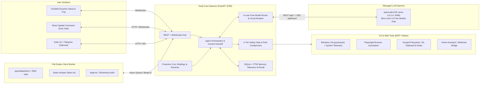
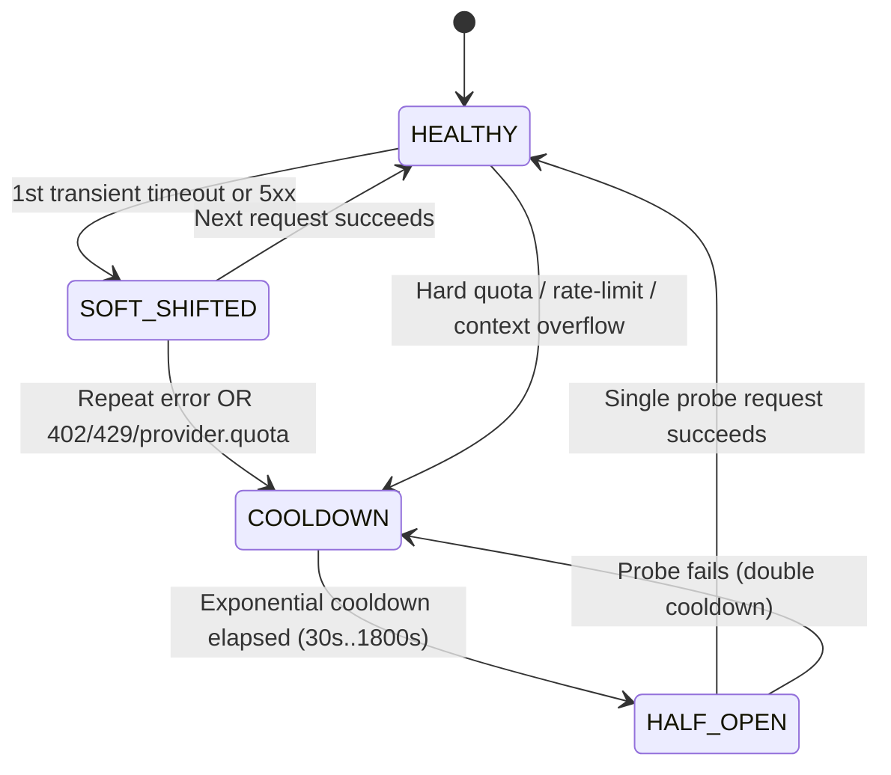
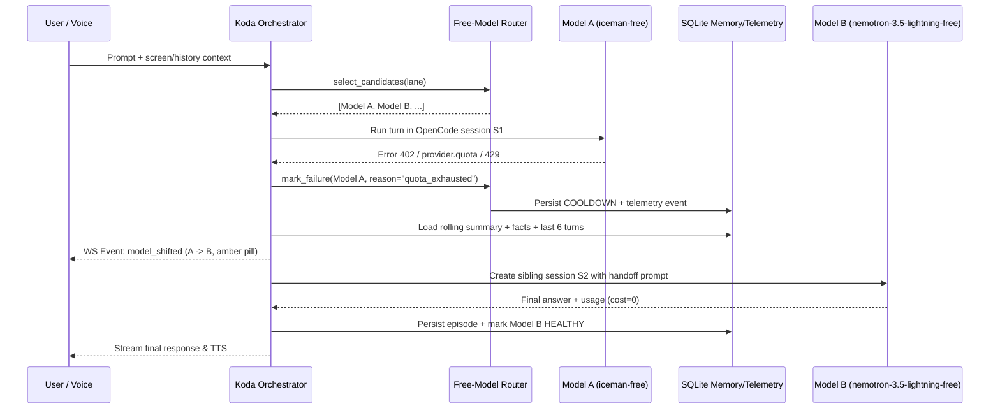

# 🏗️ KODA — System Architecture & API Contract (`ARCHITECTURE.md`)

> [!IMPORTANT]
> **Architectural Truth Source:** All OpenCode endpoints, schemas, and model payloads in this document were **empirically verified against `C:\Users\karth\.opencode\bin\opencode.EXE serve` (`v2.2.6`)** in this environment.

---

## 📋 Metadata

| Property | Value |
| :--- | :--- |
| **Architecture Style** | Local-First Modular Monolith + Supervised OpenCode Runtime + Dual-Surface HUD |
| **Backend Core** | Python `3.13` · FastAPI · Pydantic v2 · `asyncio` · `httpx` · SQLite (`FTS5`) |
| **LLM Runtime** | Managed `opencode.EXE serve` (`v2.2.6`) behind `/api/*` + HTTP Basic Auth |
| **Desktop Surfaces** | 1. Spatial Command Deck (`React 19 + Vite + TS`) · 2. Native PySide6 Dynamic Island + Tray · 3. `koda` CLI |
| **Last Updated** | `2026-11-11` |

---

## 🧭 Table of Contents

- [1. High-Level System Topology](#1--high-level-system-topology)
- [2. Verified OpenCode v2.2.6 API Contract](#2--verified-opencode-v226-api-contract)
- [3. Free-Model Router & Failover Sequence](#3--free-model-router--failover-sequence)
- [4. SQLite Persistent Memory & Telemetry Schema](#4--sqlite-persistent-memory--telemetry-schema)
- [5. Tool Execution Loop & 4-Tier Safety Engine](#5--tool-execution-loop--4-tier-safety-engine)
- [6. Full-Duplex Voice & Dual-Surface HUD Design](#6--full-duplex-voice--dual-surface-hud-design)
- [7. Planned Repository Layout](#7--planned-repository-layout)

---

## 1. 🌐 High-Level System Topology



---

## 2. 🔌 Verified OpenCode `v2.2.6` API Contract

> [!CAUTION]
> **Verified Protocol Quirks (`opencode.EXE 2.2.6`):**
> 1. Root routes (`/`, `/session`, `/doc`) return the HTML Web SPA. **All JSON API routes sit under `/api/*`** (`GET /openapi.json` documents them).
> 2. Setting `OPENCODE_SERVER_USERNAME` and `OPENCODE_SERVER_PASSWORD` in child-process env secures `/api/*` and `/openapi.json` via HTTP Basic Auth.
> 3. In `GET /api/model`, `cost` is a **`list` of tier objects** (e.g., `[{"input": 0, "output": 0, "cache": {"read": 0, "write": 0}}]`), **NOT** a flat `dict`. Always inspect every tier when enforcing `$0`.
> 4. `POST /api/session/{sessionID}/model` expects `{"model": {"providerID": "opencode", "id": "<model_id>"}}` (`"id"`, **not** `"modelID"`, `additionalProperties: false`) and returns `204 No Content`.
> 5. `POST /api/session` returns `{"data": {"id": "ses_...", ...}}`; session ID is wrapped inside `"data"`.
> 6. `POST /api/session/{sessionID}/prompt` accepts `{"text": "...", "files"?: [...], ...}` (`additionalProperties: false`).
> 7. **Do NOT query `/api/experimental/usage/limits`** on startup or hot paths (observed timing out at `> 5s`). Rely on local SQLite telemetry + immediate assistant/SSE error detection (`402`, `429`, `provider.quota`, timeouts).

### Verified Endpoint Table

| Method & Path | Request Shape | Response / Purpose |
| :--- | :--- | :--- |
| `GET /api/info` | None | `200` `{"version": "2.2.6", ...}` — fast readiness probe |
| `GET /api/model` | None | `200` `{"data": [...]}` — live free-model allowlist discovery |
| `POST /api/session` | `{"title": "..."}` | `200` `{"data": {"id": "ses_..."}}` — create isolated session |
| `POST /api/session/{id}/model` | `{"model": {"providerID": "opencode", "id": "..."}}` | `204` — pin target free model to session |
| `POST /api/session/{id}/prompt` | `{"text": "...", "files"?: [...]}` | `200` `{"data": {"id": "msg_..."}}` — submit prompt |
| `GET /api/session/{id}/message` | None | `200` `{"data": [...]}` — inspect `content`, `tokens`, `cost`, `error` |
| `GET /api/event` | SSE stream | Real-time `session.text.delta`, `session.execution.failed`, `session.usage.updated` |
| `DELETE /api/session/{id}` | None | `204` — clean session teardown |

---

## 3. 🚦 Free-Model Router & Failover Sequence

### Dynamic Lane Assignment Strategy
Models discovered from `/api/model` (`providerID == "opencode"` and all `cost` tiers `== 0`) are ranked per lane using observed live telemetry (`ewma_latency_ms`, `recent_success_rate`) plus capability priority:

| Lane | Intended Workload | Capability Filter | Priority Seed Order (Dynamically Filtered) |
| :--- | :--- | :--- | :--- |
| `fast` | Voice chat, quick Q&A, tool dispatch | `text` in `capabilities.input`, fast RTT | `iceman-free`, `nemotron-3.5-lightning-free`, `flint-40b-free`, `beam-free`, `big-pickle` |
| `vision` | Screen capture, UI inspection, image Q&A | `image` in `capabilities.input` | `nemotron-3.5-super-vl-free`, `deepseek-v4.1-flash-free`, `inkling-2-small-free`, `longcat-2.5-free` |
| `deep_1m` | Multi-file synthesis, research, briefings | Large context / high reasoning models | `nemotron-3.5-lightning-free`, `minimax-m3.1-flash-free`, `glm-5.3-flash-free`, `deepseek-v4.1-flash-free`, `big-pickle` |
| `multimodal` | Audio/video clips + rich media files | `audio` or `video` in `capabilities.input` | `mimo-v2.6-flash-free`, `minimax-m3.1-flash-free`, `glm-5.3-flash-free` |

### Circuit-Breaker State Machine & Context Handoff





---

## 4. 🗄️ SQLite Persistent Memory & Telemetry Schema

All persistent state lives inside `data/koda.db` (WAL mode enabled):

| Table | Purpose | Key Columns |
| :--- | :--- | :--- |
| `facts` + `facts_fts` | Long-term user facts & preferences (FTS5 indexed) | `id, category, key, value, confidence, source, updated_at` |
| `episodes` + `episodes_fts` | Conversation turns & rolling summaries per task | `id, conversation_id, role, content, model_id, lane, tokens_in, tokens_out, created_at` |
| `router_telemetry` | Circuit-breaker & EWMA latency state per model | `model_id, state, fail_count, cooldown_until, ewma_latency_ms, total_tokens, last_error, updated_at` |
| `router_shifts` | Auditable log of every automatic model failover | `id, from_model, to_model, reason, lane, conversation_id, created_at` |
| `approvals` | Pending & resolved Tier-3 HITL confirmations | `id, tool_name, args_json, summary, tier, status, created_at, resolved_at` |
| `audit_log` | Immutable tool execution & permission audit log | `id, actor, tool_name, tier, decision, summary, result_status, created_at` |
| `clipboard_history` | Privacy-filtered local clipboard history | `id, content, content_hash, source_app, pinned, created_at` |
| `routines` | Reusable multi-step workflow macros & schedules | `id, name, trigger_phrase, steps_json, cron_expr, enabled, last_run_at` |
| `recall_events` + `recall_fts` | Opt-in privacy-filtered active window/OCR snippets | `id, app_name, window_title, summary_text, created_at` |

---

## 5. 🛡️ Tool Execution Loop & 4-Tier Safety Engine

Koda runs an explicit structured tool-dispatch loop on top of OpenCode sessions:
- OpenCode models receive Koda's concise system prompt + active tool schemas (plus structured `<koda_tool>{"name": ..., "args": ...}</koda_tool>` protocol when deterministic parsing across diverse free models is needed).
- Before executing any requested tool, `SafetyGate.evaluate(tool_name, args)` enforces:
  1. **`DENY`** -> Blocked immediately (credential files `.env`/`*.pem`, `C:\Windows`, registry edits, privilege escalation).
  2. **`CONFIRM`** -> Enqueues an `ApprovalRequest`, pushes `approval_required` over WebSocket + Dynamic Island, and suspends execution until user approves (or times out / denies).
  3. **`NOTIFY`** -> Executes asynchronously and posts a toast/feed card (`open_app`, `focus_window`, `browser_navigate`, `set_volume`).
  4. **`AUTO`** -> Executes immediately (`system_metrics`, `memory_recall`, `read_allowed_file`, `active_window_info`).

---

## 6. 🎙️ Full-Duplex Voice & Dual-Surface HUD Design

- **Voice Worker:** Runs audio capture + `openWakeWord` + RMS/VAD segmentation + `faster-whisper` (`compute_type="int8"`/`"float16"` with graceful fallback) in a dedicated non-blocking worker/thread pool. Calling `barge_in()` flips an `asyncio.Event` / `threading.Event` that immediately halts `sounddevice.stop()` and clears queued TTS audio buffers in `< 150 ms`.
- **Dual-Surface UI:**
  - **Spatial Command Deck (`frontend/`):** React 19 + Vite + TypeScript HUD served over local HTTP/WS (`DESIGN.md` Obsidian `#0A0D14` + Porcelain `#F5F0E6` + Jewel accents).
  - **Native PySide6 Island & Tray (`koda/ui/island.py`):** Frameless always-on-top rounded pill anchored top-center showing real-time orb state (`idle`, `listening`, `thinking`, `shifting`, `speaking`, `confirm_needed`), system tray icon, and global `Ctrl+Space` activation.

---

## 7. 📁 Planned Repository Layout

```text
l:\pr 26.2(jarvis anti\
├── pyproject.toml
├── .env.example
├── .gitignore
├── run_koda.bat
├── PRD.md / ARCHITECTURE.md / RULES.md / DESIGN.md / PHASES.md / MEMORY.md / AGENTS.md / README.md
├── koda/
│   ├── __init__.py
│   ├── config.py                  # Pydantic v2 settings + zero-cost guards
│   ├── cli.py                     # CLI entrypoint (serve, ask, doctor, island)
│   ├── opencode/
│   │   ├── client.py              # Async HTTP + SSE client for OpenCode v2.2.6 /api/*
│   │   ├── supervisor.py          # Managed opencode.EXE serve lifecycle & watchdog
│   │   └── models.py              # Strict cost==0 dynamic filter + 4-lane taxonomy
│   ├── router/
│   │   ├── state.py               # Circuit breaker states + SQLite telemetry sync
│   │   └── engine.py              # Automatic failover + context-preserving handoff
│   ├── memory/
│   │   ├── store.py               # SQLite WAL + FTS5 facts, episodes, clipboard, recall
│   │   └── extractor.py           # Deterministic & LLM-assisted user fact extraction
│   ├── safety/
│   │   └── gate.py                # 4-tier policy evaluator + canonical path containment
│   ├── tools/
│   │   ├── registry.py            # Unified tool metadata & OpenCode prompt schema builder
│   │   ├── system_os.py           # psutil telemetry + pywinauto UIA window/app actions
│   │   ├── filesystem.py          # Scoped read/write/search/git + safe gated shell
│   │   ├── browser.py             # Playwright navigation, extraction & YouTube control
│   │   ├── productivity.py        # Smart clipboard, Obsidian/Markdown notes, routines
│   │   └── integrations.py        # Web research digest & Home Assistant / webhook bridge
│   ├── voice/
│   │   └── pipeline.py            # Wake word, VAD, faster-whisper STT, edge-tts, barge-in
│   ├── daemon/
│   │   ├── scheduler.py           # Morning briefings, cron timers, Recall observer
│   │   └── telegram_bridge.py     # Optional allowlisted Telegram control bridge
│   ├── gateway/
│   │   └── app.py                 # FastAPI REST + WebSocket hub + Orchestrator loop
│   └── ui/
│       └── island.py              # PySide6 Dynamic Island pill + System Tray
├── frontend/                      # Vite + React + TS Spatial Command Deck
└── tests/                         # Mirroring pytest suites per module
```
